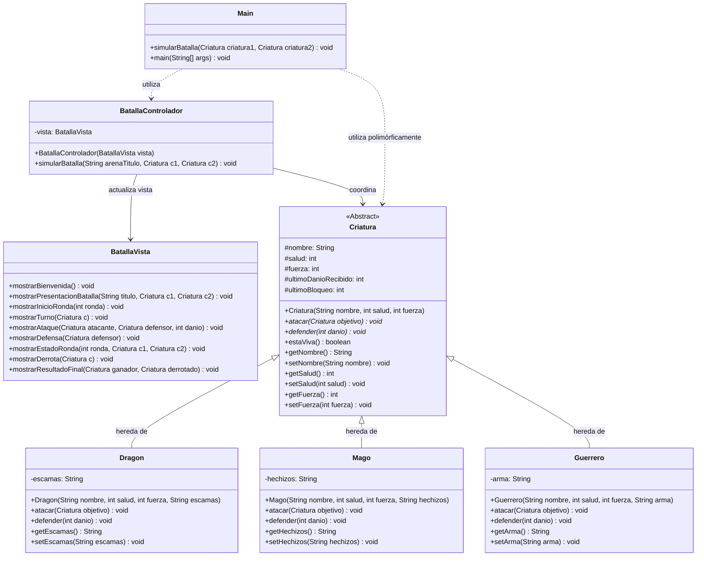

# Parcial II - Parte Práctica Programación II (G412)

## Simulador de Batallas entre Criaturas (Arquitectura MVC y Polimorfismo)

Proyecto desarrollado para el **Parcial II de Programación II**, enfocado en la aplicación rigurosa de los principios de la **Programación Orientada a Objetos (POO)**: Abstracción, Herencia, Encapsulamiento y Polimorfismo, estructurado bajo el patrón arquitectónico **Modelo - Vista - Controlador (MVC)** y ambientado temáticamente con héroes y tropas de **Clash Royale**.

---

## 👥 Integrantes del Equipo

- **Johhan González** (`JohhanG`)
- **Eva** (`Eva`)

---

Durante el desarrollo del parcial practico se trabajo en equipo y se busco implementar lo aprendido mediante clases abstractas y polimorfismo, se resolvieron conflictos de merge y documentar el trabajo en equipo

Se trabajó en equipo en ramas separadas. Al unir los cambios hubo conflictos porque entre las ramas se modifico el mismo archivo. Se resolvieron revisando ambas versiones, y el equipo se comunicó y dividió las partes para evitar que se vuelvan a editar las mismas lineas.

## 🏛️ Arquitectura del Proyecto (Patrón MVC)

El proyecto separa estrictamente la lógica de datos, la orquestación del juego y la presentación visual en consola:

```text
Parcial 2/
├── 📁 modelo/
│   ├── Criatura.java            # Clase abstracta base (Atributos, métodos abstractos y concreto)
│   ├── Guerrero.java            # Subclase concreta (Atributo específico: arma)
│   ├── Mago.java                # Subclase concreta (Atributo específico: hechizos)
│   └── Dragon.java              # Subclase concreta (Atributo específico: escamas, fuerza * 2)
├── 📁 vista/
│   └── BatallaVista.java        # Capa de presentación (Formato, interfaces y mensajes de consola)
├── 📁 controlador/
│   └── BatallaControlador.java  # Capa de control (Orquestación de rondas, turnos y reglas de batalla)
├── 📁 test/
│   └── CriaturaTest.java        # Pruebas unitarias automatizadas con JUnit 5
├── 📁 lib/
│   └── junit-platform-console-standalone-1.10.2.jar # Dependencia standalone de JUnit 5
├── 📄 Main.java                 # Punto de entrada y método polimórfico simularBatalla(...)
├── 📄 README.md                 # Documentación técnica completa del proyecto
└── 📄 .gitignore                # Exclusión de archivos compilados (.class) y configuraciones de IDEs
```

---

## 📐 Diagrama de Clases (UML)



---

## 📋 Cumplimiento de Requisitos del Enunciado

| Requisito del Parcial             | Implementación en el Proyecto                                                                                                                                                |   Estado    |
| :-------------------------------- | :--------------------------------------------------------------------------------------------------------------------------------------------------------------------------- | :---------: |
| **1. Clase Abstracta `Criatura`** | Atributos protegidos `nombre`, `salud`, `fuerza`. Métodos abstractos `atacar(Criatura)` y `defender(int)`. Método concreto `estaViva()`.                                     | ✅ Cumplido |
| **2. Subclases Concretas**        | **`Dragon`** (fuerza duplicada `fuerza * 2` y atributo `escamas`).<br>**`Mago`** (ataque con `hechizos` y barrera mágica).<br>**`Guerrero`** (ataque con `arma` y armadura). | ✅ Cumplido |
| **3. Simulación de Batallas**     | Método `simularBatalla(Criatura, Criatura)` que ejecuta turnos alternados hasta que la salud llegue a 0, mostrando daño, mitigación y vida restante.                         | ✅ Cumplido |
| **4. Polimorfismo**               | Invocación dinámica de métodos (`atacar` y `defender`) sin importar el tipo específico de criatura recibida en tiempo de ejecución.                                          | ✅ Cumplido |
| **5. Arquitectura MVC**           | Capa `modelo` sin salidas de consola; capa `vista` exclusiva para la interfaz de texto; capa `controlador` para el flujo de batallas.                                        | ✅ Cumplido |
| **6. Control de Versiones Git**   | Trabajo en equipo en ramas independientes (`johhang`, `Eva`), pull requests aprobados y fusionados, y commits semánticos ordenados.                                          | ✅ Cumplido |
| **7. Pruebas Unitarias (JUnit 5)**| 9 pruebas unitarias automatizadas (`CriaturaTest.java`) evaluando mitigación de daño, daño potenciado, polimorfismo y supervivencia.                                           | ✅ Cumplido |

---

## ⚙️ Compilación y Ejecución

Para compilar y ejecutar el proyecto desde la consola o terminal (Bash, PowerShell o CMD):

```bash
# 1. Compilación de todos los paquetes MVC y la clase Main
javac modelo/*.java vista/*.java controlador/*.java Main.java

# 2. Ejecución del simulador de batallas
java Main

# 3. Compilación y ejecución de las pruebas unitarias (JUnit 5)
javac -cp ".;lib/*" modelo/*.java test/*.java
java -jar lib/junit-platform-console-standalone-1.10.2.jar execute --class-path . --scan-class-path
```

---

## ⚔️ Héroes y Batallas Configuradas

En la simulación se configuran enfrentamientos entre campeones y tropas de Clash Royale:

- **Arena 1:** `Caballero Dorado` (Guerrero con _Espada Real Dorada_) vs `Dragón Infernal` (Dragón con _Casco Blindado y Escamas Térmicas_).
- **Arena 2:** `Mago de Fuego` (Mago con _Fireball_) vs `Mega Caballero` (Guerrero con _Guanteletes de Acero con Puntas_).
- **Arena 3:** `Mago Eléctrico` (Mago con _Electrificación Zapp!_) vs `Bebé Dragón` (Dragón con _Escamas Ígneas Volcánicas_).
